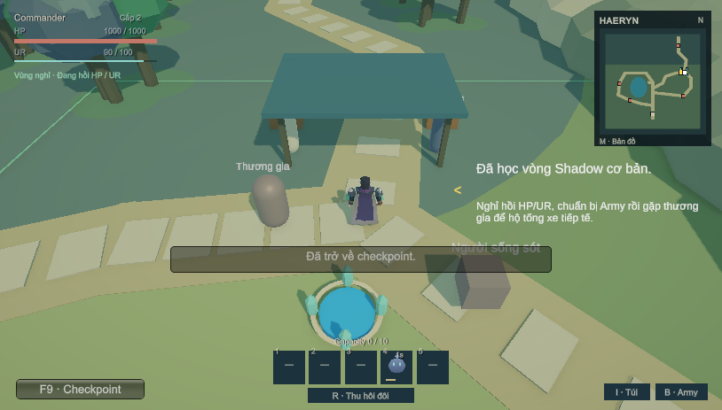

# The Wone: Shadows

*English · [Tiếng Việt](README.vi.md) · [Portfolio](../README.md)*

**Solo gameplay project · Unity 6 / C#**

An original action RPG about collecting and commanding Shadows in a Vietnamese-inspired fantasy world. The current PC prototype is a playable opening set in Haeryn.

## A playable encounter

After learning to summon and recall an owned Slime Leader, the player escorts a supply cart. A Goblin attacks the cart while a Wolf tries to steal its cargo. The player can engage one enemy while their Shadow holds the other. Losing the cart, the remaining cargo, or the player restores the departure checkpoint and lets the player try again.

## Gameplay systems I built

- **Combat and AI.** Melee attacks commit to a target through windup, impact, and recovery. Owned Shadows choose nearby threats while idle and hold a valid opponent during combat, even when the player switches targets. An isolated Editor arena lets me compare flanking, guarding, telegraphs, and enemy search before using selected behaviors in a quest.
- **Shadow ownership and Army.** Each owned Shadow has a stable ID and its own progression. Army assignments refer to those IDs. Summoning and recall preserve each Shadow’s HP and recovery state while enforcing slot, capacity, and UR rules.
- **Quests and persistence.** NPC and world state follow quest progress. Tutorial stages unlock actions in order. A versioned checkpoint restores the quest, inventory, and Army state together. During the escort, failure reloads the same departure snapshot before rebuilding the encounter.

I verified the attack timing, independent Shadow targeting, and the escort’s failure, retry, and completion through Unity Play Mode scenarios. Those scenarios use an isolated save path and exercise actual damage, quest interactions, and scene reloads.

## Public Unity sample

This folder contains the earlier **TWS-Lite** prototype, with movement, basic combat, enemy AI, and early summoning code. Add this folder to Unity Hub and open `Assets/Scenes/main.unity` with **Unity 6000.4.9f1**, the version pinned in the sample. [Project version](ProjectSettings/ProjectVersion.txt) · [Early gameplay demo](../docs/TWS-prototype-Demo.gif)

The current Haeryn project is in a private repository. For a walkthrough or source access, [email me](mailto:danganhvan40@gmail.com).
