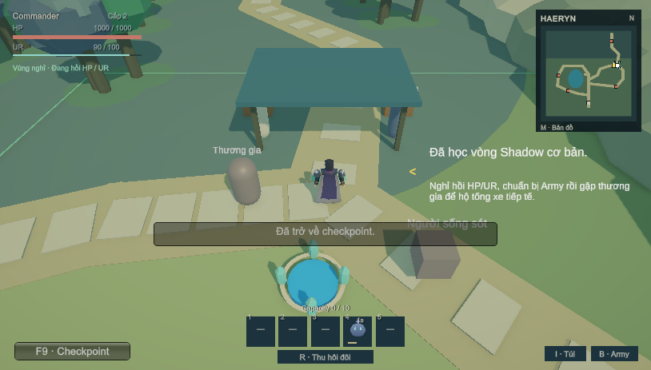

# The Wone: Shadows

*[English](README.md) · Tiếng Việt · [Portfolio](../README.vi.md)*

**Dự án gameplay cá nhân · Unity 6 / C#**

Game action RPG nguyên bản xoay quanh thu thập và điều khiển Shadow, trong thế giới fantasy lấy cảm hứng từ văn hóa Việt Nam. Prototype PC hiện có một đoạn mở đầu chơi được tại Haeryn.

## Một nhiệm vụ trong bản hiện tại

Sau khi học triệu hồi và thu hồi Slime Leader của mình, người chơi hộ tống xe tiếp tế. Goblin nhắm vào thân xe, còn Wolf tìm cách cướp hàng. Người chơi có thể đánh một con trong khi Shadow giữ con kia. Nếu xe bị phá, hàng bị cướp hết hoặc người chơi gục, game tải lại checkpoint khởi hành để thử lại.

## Các hệ thống mình xây

- **Combat và AI.** Đòn cận chiến cam kết mục tiêu qua nhịp chuẩn bị, trúng đòn và hồi đòn. Shadow đang rảnh tự chọn mối đe dọa gần người chơi. Khi đã giao chiến, nó giữ đối thủ hợp lệ dù người chơi đánh sang con khác. Mình dùng bãi thử riêng trong Unity Editor để so hành vi đánh sườn, hộ vệ, báo đòn và tìm kiếm trước khi đưa hành vi phù hợp vào nhiệm vụ.
- **Sở hữu Shadow và Army.** Mỗi Shadow có ID ổn định và tiến trình riêng. Army gán theo ID cá thể. Triệu hồi và thu hồi giữ trạng thái HP, thời gian hồi phục và kiểm tra điều kiện ô đội, Capacity và UR.
- **Nhiệm vụ và lưu tiến trình.** NPC và thế giới thay đổi theo chặng truyện. Tutorial mở từng thao tác đúng lúc. Checkpoint có phiên bản và khôi phục nhiệm vụ, túi, Army cùng nhau. Khi hộ tống thất bại, game tải mốc khởi hành rồi dựng lại trận.

Mình kiểm tra nhịp đòn, khả năng chia mục tiêu giữa Player và Shadow, cùng các lượt thua, thử lại và hoàn tất hộ tống bằng Unity Play Mode. Các bài này dùng save riêng, có đòn đánh, tương tác nhiệm vụ và tải scene thật.

## Bản Unity công khai

Thư mục này chứa **TWS-Lite** ở giai đoạn đầu, có di chuyển, combat, AI địch và nền triệu hồi. Thêm thư mục vào Unity Hub, dùng **Unity 6000.4.9f1** và mở `Assets/Scenes/main.unity`. [Phiên bản Unity của mẫu](ProjectSettings/ProjectVersion.txt) · [Demo giai đoạn đầu](../docs/TWS-prototype-Demo.gif)

Mã nguồn Haeryn hiện tại nằm trong repo riêng. Bạn có thể [gửi email cho mình](mailto:danganhvan40@gmail.com) để trao đổi về bản hiện tại.
