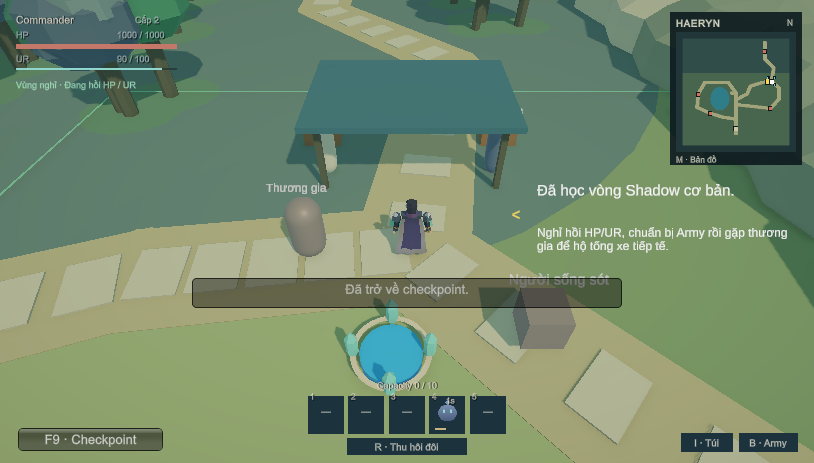

# Dang Anh Van — Game Engineer

*English · [Tiếng Việt](README.vi.md)*

I build gameplay systems in Unity and C#, and developer tools that help me work on those systems as the project grows.

## Projects

### The Wone: Shadows · Unity / C#

An original solo action RPG project set in a Vietnamese-inspired fantasy world. The current **Haeryn vertical slice** connects the story opening, exploration, Shadow collection, army setup, and combat. It ends with a supply-cart defense where the player and their summoned Shadow can hold different enemies.

I built the combat and AI, the lifecycle of owned Shadow instances, and the checkpoint system that restores quest and party state together. [Gameplay engineering case study](02-TWS-Lite/README.md)

### DevOS · Node.js CLI

I built DevOS to answer a practical question that came up while developing TWS: which files, systems, and rules should I review before making this change? DevOS compiles project evidence into feature ownership, dependencies, and architecture context, then lets developers and coding agents query it from the terminal.

The current runtime, product guide, and regression suite are public. [DevOS engineering case study](01-DevOS-Lite/README.md) · [Current source](https://github.com/Heavant/DevOS)

## Contact

For a walkthrough or access to the current TWS source, [email me](mailto:danganhvan40@gmail.com). The public portfolio includes a playable early Unity snapshot and the current project case study.
