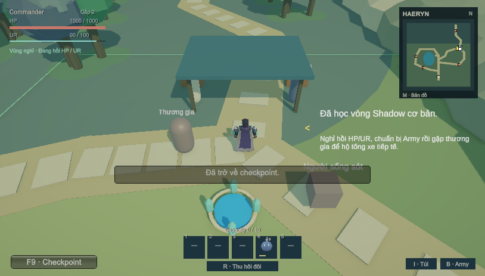

# Dang Anh Van — Game Engineer

*[English](README.md) · Tiếng Việt*

Mình xây hệ thống gameplay bằng Unity và C#, đồng thời viết công cụ hỗ trợ phát triển khi dự án lớn dần.

## Dự án

### The Wone: Shadows · Unity / C#

Dự án action RPG cá nhân, lấy cảm hứng từ văn hóa Việt Nam. **Bản chơi thử Haeryn** hiện nối phần mở đầu, khám phá, thu thập Shadow, xếp đội và chiến đấu. Đoạn này kết bằng nhiệm vụ bảo vệ xe tiếp tế, nơi người chơi và Shadow có thể giữ hai đối thủ khác nhau.

Mình xây combat và AI, vòng đời từng Shadow sở hữu, cùng checkpoint khôi phục đồng thời tiến độ nhiệm vụ và trạng thái đội hình. [Chi tiết kỹ thuật gameplay](02-TWS-Lite/README.vi.md)

### DevOS · CLI Node.js

Mình xây DevOS từ một vấn đề khi làm TWS: trước khi sửa một tính năng, cần đọc những file, hệ thống và luật nào? DevOS biên dịch dữ liệu về quyền sở hữu file, phụ thuộc và kiến trúc theo tính năng để người phát triển và coding agent có thể tra cứu ngay trong terminal.

Runtime hiện tại, hướng dẫn và bộ kiểm thử đều công khai. [Chi tiết kỹ thuật DevOS](01-DevOS-Lite/README.vi.md) · [Mã nguồn hiện tại](https://github.com/Heavant/DevOS)

## Liên hệ

Nếu muốn xem demo trực tiếp hoặc trao đổi quyền xem mã nguồn TWS hiện tại, bạn có thể [gửi email cho mình](mailto:danganhvan40@gmail.com). Portfolio có bản Unity mẫu chơi được và phần trình bày kỹ thuật của phiên bản hiện tại.
